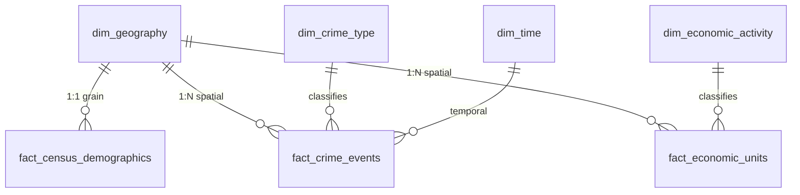

# Dimensional Data Warehouse Architecture & Data Dictionary
**Target Schema**: `urban_intelligence_cdmx`  
**Projection**: `EPSG:6372` (ITRF2008 / Mexico LCC)  
**Grain**: AGEB Urbana (Marco Geoestadístico 2020)

## Table Specifications

### 1. `dim_geography`
- **Grain**: 1 row per official urban census tract (AGEB).
- `cvegeo` (PK, VARCHAR(13)): Composite official key (Entidad + Municipio + Localidad + AGEB).
- `cve_ent` (VARCHAR(2)): Federal entity code ('09' for CDMX).
- `cve_mun` (VARCHAR(3)): Municipality/Alcaldía code (001 to 016).
- `cve_loc` (VARCHAR(4)): Locality code.
- `cve_ageb` (VARCHAR(4)): AGEB code.
- `nom_mun` (VARCHAR(100)): Alcaldía name.
- `area_km2` (NUMERIC): Surface area in square kilometers calculated in `EPSG:6372`.
- `geom` (GEOMETRY(MultiPolygon, 6372)): Official polygon boundaries with GiST index.

### 2. `dim_crime_type`
- **Grain**: 1 row per unique crime category and classification.
- `crime_type_id` (PK, SERIAL): Auto-incrementing identifier.
- `categoria_delito` (VARCHAR(150)): Aggregated crime category.
- `delito` (VARCHAR(255)): Specific legal crime description.

### 3. `dim_economic_activity`
- **Grain**: 1 row per SCIAN economic activity.
- `activity_id` (PK, SERIAL): Auto-incrementing identifier.
- `codigo_act` (VARCHAR(10), UNIQUE): 6-digit SCIAN classification code.
- `nombre_act` (TEXT): Description of the economic activity.
- `sector_scian` (VARCHAR(2)): 2-digit SCIAN sector code.
- `categoria` (VARCHAR(50)): Grouped analytical category ('Retail', 'Services', 'Manufacturing', 'Other').

### 4. `dim_time`
- **Grain**: 1 row per calendar day.
- `date_id` (PK, DATE): Calendar date.
- `anio` (INT): Year (2020).
- `mes` (INT): Month (1-12).
- `dia` (INT): Day of month (1-31).
- `dia_semana` (INT): Day of week (1=Monday, 7=Sunday).
- `trimestre` (INT): Quarter (1-4).

### 5. `fact_census_demographics`
- **Grain**: 1 row per AGEB (1:1 with `dim_geography`).
- `cvegeo` (PK, FK, VARCHAR(13)): Links to `dim_geography`.
- `total_population` (INT): Total registered inhabitants (INEGI Censo 2020).
- `female_population` (INT): Female inhabitants count.
- `male_population` (INT): Male inhabitants count.
- `working_age_population` (INT): Inhabitants aged 15 to 64 years.
- `economically_active_population` (INT): Economically active population (PEA).
- `employed_population` (INT): Employed population count.
- `total_dwellings` (INT): Total private dwellings count.

### 6. `fact_crime_events`
- **Grain**: 1 row per geocoded crime occurrence.
- `event_id` (PK, BIGSERIAL): Auto-incrementing incident identifier.
- `cvegeo` (FK, VARCHAR(13)): Geographic boundary containing the point coordinates.
- `crime_type_id` (FK, INT): Link to `dim_crime_type`.
- `date_id` (FK, DATE): Link to `dim_time`.
- `hora` (TIME): Timestamp of occurrence.
- `latitud` (NUMERIC(10, 7)): Incident latitude coordinate.
- `longitud` (NUMERIC(10, 7)): Incident longitude coordinate.
- `geom` (GEOMETRY(Point, 6372)): Metric projected point.

### 7. `fact_economic_units`
- **Grain**: 1 row per physical business establishment (DENUE).
- `unit_id` (PK, BIGSERIAL): Auto-incrementing establishment identifier.
- `id_denue` (VARCHAR(50)): INEGI DENUE establishment identifier.
- `cvegeo` (FK, VARCHAR(13)): Geographic boundary containing the establishment.
- `activity_id` (FK, INT): Link to `dim_economic_activity`.
- `estrato_ocupacion` (VARCHAR(50)): Employment size bracket (e.g., '0 a 5 personas').
- `latitud` (NUMERIC(10, 7)): Establishment latitude coordinate.
- `longitud` (NUMERIC(10, 7)): Establishment longitude coordinate.
- `geom` (GEOMETRY(Point, 6372)): Metric projected point.
